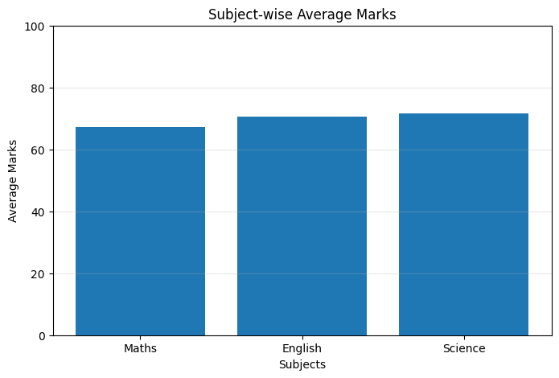

# Student Performance Analysis

## Project Overview
This is a beginner-level Python project focused on statistical analysis of student marks.

## Objectives
- Calculate average marks.
- Identify highest and lowest marks.
- Count passed and failed students.
- Understand basic statistical calculations using Python.

## Technologies Used
- Python
- Lists
- Loops
- Conditional Statements
- Built-in Functions

## Analysis
The program calculates basic performance indicators using a sample dataset of student marks.

## Learning Outcomes
- Python fundamentals
- Data handling
- Basic statistical analysis
- Logical problem solving

## Author
Shivam Malik

GitHub: https://github.com/shivamquantlab

## Data Visualization

### Subject-wise Average Marks

## Key Findings

- Total Students: 8
- Class Average: 69.79
- Topper: Priya (91.67)
- Best Subject: Science (71.62)
- Weakest Subject: Maths (67.25)
- Pass Percentage: 87.5%

## Conclusion

This project demonstrates how Python can be used
to analyze student performance using statistical
calculations and data visualization.
